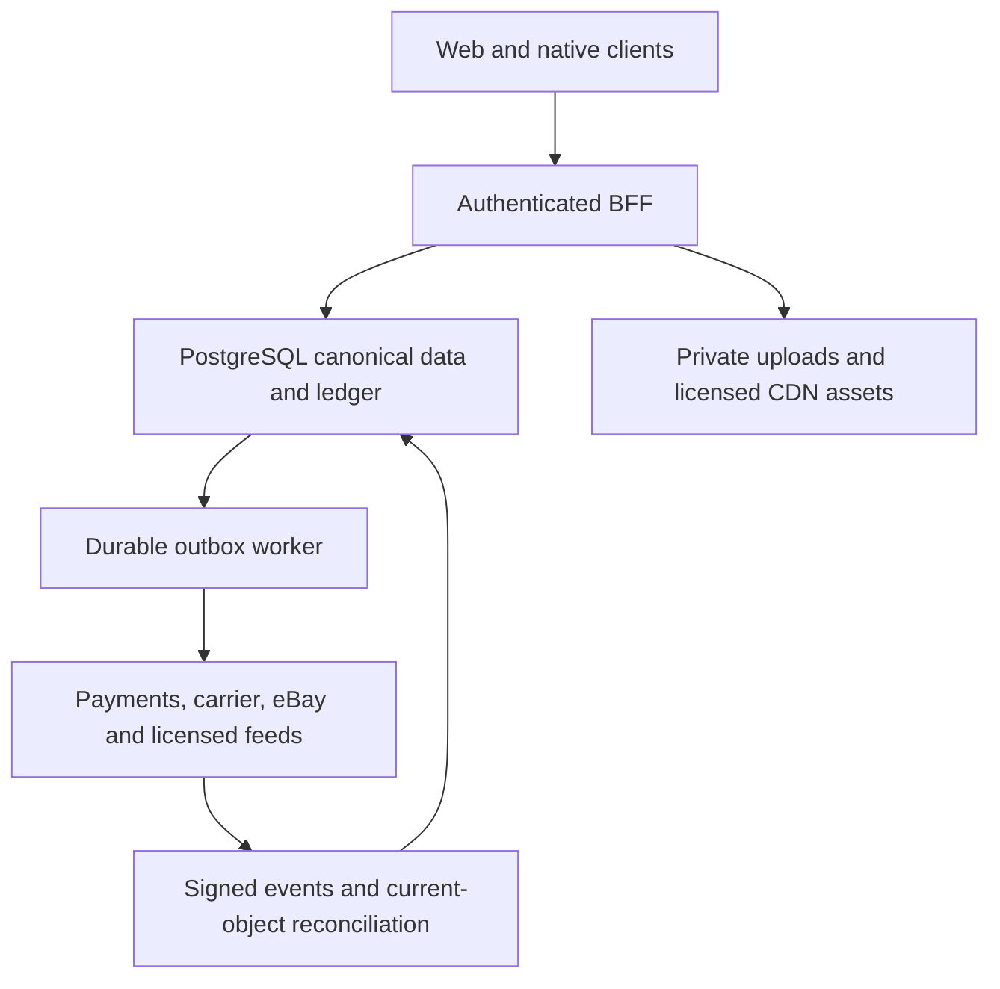
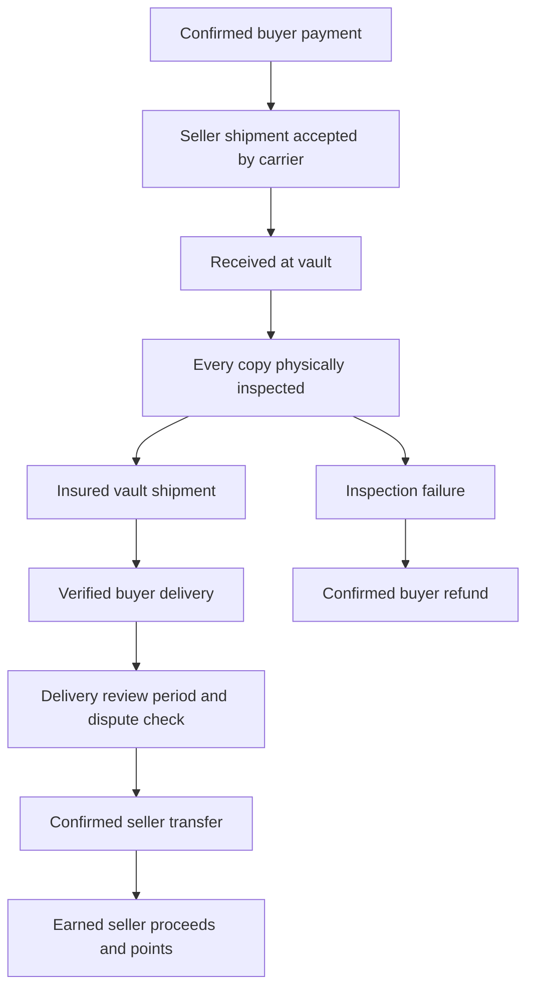

# ComicHuddle: full-stack platform architecture and implementation

Version: 2026-10-14. US-only launch. This package contains executable PostgreSQL migrations, TypeScript domain services, React/Tailwind components, and integration tests. The homepage is integrated with the existing private website. The new PostgreSQL payment, wallet, AI and eBay services are reference implementation modules for the next backend deployment; they have not been activated against production accounts.

## What ships, and what is actually live

| Module | Implementation | Deployment state |
|---|---|---|
| 1. Homepage | `ui/Homepage.tsx`, `src/home-feed.ts`, `app/collector-home.tsx`, `app/platform-v2.css` | Redesigned homepage reads the existing central catalog and opens existing details/scanner/profile/workshop. Market values and rewards remain visibly planned until their sources/services are enabled. |
| 2. PostgreSQL | `sql/001-platform.sql`, `002-roles-and-guards.sql`, `003-moderation-and-migration.sql` | Applied to an isolated PostgreSQL engine during tests. Not applied to the hosted database. |
| 3. SafeTrade / wallet | `src/checkout.ts`, `escrow.ts`, `ledger.ts`, `wallet.ts`, `rewards.ts`, `returns.ts`, `fulfillment.ts`, `providers.ts`, `worker.ts` | Tested with provider fixtures. Production flags default OFF. |
| 4. Scan / listing verification | `src/scans.ts`, `inventory-fingerprint.ts` | Edition evidence classifier, model gateway contract, owned-image checks and human-review gate implemented. Real AI gateway requires deployment and evaluation. Existing camera scanner remains available. |
| 5. FMV | `src/fmv.ts`, `valuation-store.ts`, `home-feed.ts` | Adapter classes, rights toggles, exact-grade estimation and price alerts implemented. Restricted/licensed provider clients are explicit integration ports. No fabricated sold API or data. |
| 6. Cards / CGC | `ui/DirectoryCard.tsx`, `CollectionModal.tsx`, `Dialog.tsx`, `cgc-links.ts` | Portrait cards, two-column mobile grid, grade controls, save/buy callbacks, modal and verified CGC destinations included. |
| 7. eBay | `src/ebay.ts`, `ebay-draft.ts`, `inventory-fingerprint.ts` | Confidential OAuth, encrypted tokens, server-generated draft, Inventory API write calls, exact approval and ambiguous-result reconciliation implemented; official-account testing remains required. |

The hosted app currently uses Cloudflare D1 and R2. The existing `architecture/postgres` folder is an earlier PostgreSQL reference package, not evidence that the hosted app already runs on PostgreSQL. The new schema uses the isolated `ch_platform` namespace so it can coexist during a reviewed migration. No runtime secrets, hosting storage bindings, sharing policy or catalog update schedules were changed by this package.

## Architecture and trust boundaries

The browser and native app share one authenticated backend-for-frontend (BFF). Only that backend resolves the current user, creates payment amounts, checks inventory, signs image access, accesses providers and constructs eBay drafts. Worker processes perform durable provider operations from an outbox. The browser cannot select another user, mark a payment successful, invent a carrier receipt or release seller money.



Use PostgreSQL 16+ in a backend that supports a real pooled connection or a transaction-capable HTTP driver. The hosted Workers runtime has no raw TCP. Do not import a Node `pg` TCP client into its existing D1 routes; deploy the PostgreSQL BFF separately or use a reviewed provider transport with real transaction isolation. `SqlPool` is intentionally driver-neutral. Backend service login credentials must be server-only, non-superuser and non-owner. Browsers never receive a database service credential.

## Module 1: homepage and collector UX

The design uses warm paper, ink, collector red, gold, portrait covers and restrained comic typography. The hero offers search by title, character or key term, Scan a Book, Value Collection, Browse Keys and a direct marketplace entry. The existing circular scan action remains in the mobile bottom navigation.

The search component debounces input, aborts outdated requests, rejects stale responses and supports arrow keys, Escape and Enter. Exact results open the directory detail flow. Cards have a fixed portrait media region and a two-column mobile grid. Failed or unavailable licensed covers show a clearly labeled metadata panel rather than invented artwork.

`buildHomeFeed` supplies actual indexed counts, approved key claims, verified film tags and verified incentive ratios. Trending order is based on recorded completed collector activity; without activity the UI calls the section editorial selections. Film connections and ratio rankings remain empty when verified metadata is missing. Never generate a top-ten list simply to fill a page.

The market ticker requires comparable same-grade, same-method quotes around a 24-hour anchor. It does not compare a current asking price with an old historical sale. The deployed catalog bridge intentionally supplies no FMV until a valuation source is connected. The server feed helper can replace that bridge after the PostgreSQL cutover. Raw card pricing is specifically Raw NM; other raw conditions have their own keys.

Cover metadata and cover rights are separate. The retained vintage homepage spotlight uses existing US public-domain Planet Comics covers. Modern covers require authorized display rights. Source terms must also explicitly permit image storage/CDN use and model recognition if those uses are planned.

## Module 2: schema and integrity

Apply these files **once**, in order, to an empty `ch_platform` namespace under a reviewed operator migration:

```sh
psql "$COMICHUDDLE_DATABASE_URL" -v ON_ERROR_STOP=1 -f sql/001-platform.sql
psql "$COMICHUDDLE_DATABASE_URL" -v ON_ERROR_STOP=1 -f sql/002-roles-and-guards.sql
psql "$COMICHUDDLE_DATABASE_URL" -v ON_ERROR_STOP=1 -f sql/003-moderation-and-migration.sql
```

The full executable DDL is in those files. It is not an automatic production migration or an idempotent bootstrap script. Managed providers that prohibit role creation need an operator to map the role grants to their supported service roles; do not skip the grants or give the app an owner login.

Key relationships:

- `publishers → series → comics` identifies an exact edition, including printing number and variant code. IDs are UUIDs; issue numbers remain text for fractions, annuals, specials and nonnumeric identifiers.
- `comic_keys` joins verified editorial categories and debut claims to issues. `comic_characters`, `variants` and rights-aware `comic_images` supply browse/search and scan evidence.
- `grade_profiles` separates raw condition, grader, numerical grade, label and attributes. A CGC Universal 9.8 comparable is not a signature-series, restored, CBCS or Raw NM comparable.
- `user_collections` is a collection header. `collection_items` is one physical copy. Two copies of the same issue get different physical-copy IDs. Cost and private notes are separate from seller-published condition notes.
- Every `marketplace_listings` row references a central comic ID. A collection listing uses that anchor plus `listing_items` linking every physical copy. Composite owner/copy/comic foreign keys prevent listing somebody else's copy or assigning the wrong issue.
- A partial unique reservation index prevents the same physical copy appearing in two active/reserved listings. Deferred checks enforce single-vs-collection cardinality, anchor membership, canonical/custom flags and reservation state.
- Orders seal price, discount, taxes, shipping, participants and inventory snapshots before a payment is requested. Bundle sales do not create fictitious per-book comps.
- `fmv_records` is append-only history, not a mutable price field on a comic. `fmv_record_sources` records every contributing source. An asking-range record has **no FMV value**. Raw unknown condition cannot have a trusted quote.
- `escrow_transactions`, `escrow_events`, `return_cases`, `outbox_jobs`, `operation_requests` and `provider_events` preserve state, receipts, retries and review work.
- Seller wallets are derived from a double-entry ledger. Deferred triggers require each posting to balance and block negative available/reserved/held funds. Cash is integer cents; API amounts use decimal strings. No floating-point financial arithmetic.
- Collector access uses row-level security. The service role is a fixed backend role, never a role chosen by an HTTP request. Token and OAuth-session tables are not collector-readable.

Important indexes cover directory series/title/barcode/status, exact-grade quotes and comps, active listings, collection ownership, reservations, moderation, wallet history and worker queues. At full-catalog scale, profile `EXPLAIN (ANALYZE, BUFFERS)` with the actual dataset before choosing additional covering/search indexes or a search engine.

### Migration from the current application

Use `legacy_identity_map` to preserve the existing D1/GCD/Metron numeric IDs and authentication subjects while assigning PostgreSQL UUIDs. Do not convert numeric IDs to arbitrary UUIDs in a browser. Existing PostgreSQL-reference `user_collections` rows represent physical copies; the new collection header and copy tables require an explicit mapping.

A safe migration has a read-only export, immutable source checksums, staging validation, owner/foreign-key reconciliation, rejection records, counts by publisher and source, backup, sampled reads, then a controlled cutover. Keep legacy URLs resolving through the crosswalk. The package includes the crosswalk and rejection tables, not a one-click migration that guesses at the user's complete runtime data. Payment history must be reconciled to the actual provider before any balances are imported.

## Module 3: SafeTrade, money and rewards

The default high-value threshold is **$500 inclusive**, computed from the complete listing subtotal before a points discount. It is configurable and cannot be bypassed by turning the service off: an eligible order fails closed until SafeTrade is ready. Lower-value orders use the same payment/settlement machinery with direct seller-to-buyer delivery and no vault leg.



The state machine records `pending_deposit`, `funded`, `seller_shipped`, `received_at_vault`, `inspected`, `inspection_failed`, `shipped_to_buyer`, `delivered`, `release_pending`, `completed`, `disputed`, `refund_pending`, `refunded` and `cancelled`. Each transition has a permitted actor and immutable evidence. A seller cannot mark a processor payment successful. Vault operators cannot substitute an AI guess for a physical-copy inspection. Carrier delivery must match the required destination and tracking record.

The shipping deadline is 48 hours by default. A printed label alone does not satisfy it. `CarrierVerifier` must retrieve genuine acceptance evidence. Deadline refunds are confirmed through the processor before local completion. A daily deadline/release job and inspection SLA monitoring must be deployed with the BFF; the code does not reactivate any prior catalog schedules. An inspection-window policy is supplied, but automatic inspection-timeout actions and warehouse insurance/returns operations require the operator's service terms and fulfillment implementation.

`StripeConnectProvider` implements Payment Intents, separate transfers, refunds, transfer reversals, connected-account balance checks and bank payouts. `paymentWorker` handles those operations through a durable outbox. Raw webhook signatures are verified before persistence, IDs deduplicate deliveries, and workers retrieve current provider objects rather than trusting stale event snapshots. Point/reward postings are idempotent. Ambiguous money outcomes are held for reconciliation; old idempotency keys are not blindly replayed after their provider retention window.

A created transfer is distinct from a paid bank payout. A refund of a charge does not automatically reverse a seller transfer. `approveInspectedReturn` and `confirmReturnRecovery` reserve recoverable seller proceeds, confirm the reversal and then request the buyer refund. When proceeds have been withdrawn, the flow blocks for a funded recovery reserve and operator reconciliation. This avoids an invented negative wallet or an unfunded refund promise.

Stripe explicitly does not provide legal escrow services or escrow accounts. SafeTrade is an inspect-first middleman product with delayed settlement in this implementation. A genuine escrow claim requires an appropriate licensed structure/provider and legal review. Provider approval, seller KYC, manual payout configuration, restricted-business acceptance, liability/chargeback reserves, insured custody, shipping address verification and tax handling are launch dependencies. Software does not create those approvals. Do not describe the product as guaranteed scam-proof.

### Wallet and reward economics

`user_wallets` holds a seller-proceeds subledger. It does not accept consumer top-ups, transfer cash between users or offer a general stored-value buyer wallet. Bank withdrawals are limited to earned proceeds in the connected provider account, checked against local reserved/available balances and actual provider liquidity. Outstanding disputes block new withdrawal requests.

Points are purchase discounts, not withdrawable cash. Defaults: one point per merchandise dollar on a completed eligible purchase; one cent per point when redemption is enabled; maximum 10% of purchase subtotal, further capped by the platform commission. Taxes/shipping are excluded from accrual. Failed/refunded orders restore redemptions and reverse earned points; points already spent can create points debt and prevent further redemption. Listing points default to zero; the optional version requires human review, a daily cap and one lifetime claim per physical copy to deter repost farming.

Illustrative configured economics, not a revenue forecast: a $100 merchandise sale at an 8% platform fee yields $92 seller proceeds before separately agreed costs. A $1 loyalty discount can come from the $8 platform fee without reducing seller proceeds. Processor fees, operations, insurance, disputes and taxes still affect actual profit. Additional revenue options are paid SafeTrade inspection/handling, seller tools subscriptions and clearly labeled promotions. Each should have transparent terms; paid placement must never alter editorial key verification or inspection outcomes.

## Module 4: scanner and listing AI

The vision layer extracts visible evidence: full barcode/extension, title, issue number, indicia printing wording, cover-price box and publisher logo. `matchEdition` compares these observations to sourced canonical edition references. Its score is a transparent **heuristic evidence score**, not a calibrated authenticity probability. Barcode and indicia evidence are required for a high-confidence edition candidate. A close alternate match, conflicting cues or unreadable images requires review.

Supported printing labels: first, second, later printing, facsimile, reprint and unknown. A missing directory match returns an explicit message. The model gateway treats all image text as untrusted data, has a bounded structured-output schema and is not authorized to execute instructions from a photograph.

Paper age/texture, hidden restoration, page completeness, forged signatures and a real counterfeit cannot be reliably determined from arbitrary phone photos. The service always returns `authenticity: 'not_determined'` for automated scans. Do not market this classifier as a fake/original guarantee. A defensible authenticity claim needs recorded expert physical inspection.

`runSmartScan` verifies image ownership and hashes; `reviewScan` records authorized human inspection; `listingVerificationGate` requires front/back/indicia evidence for each physical copy and matching current scan hashes. High-value publication requires human review. Changing a photo invalidates the approval. A high-value collection needs evidence for every included book.

`VisionProvider` and `PhotoRepository` are injected ports. `JsonVisionGateway` is the concrete HTTP client for a **deployment-owned gateway contract**, not a fictitious public vendor endpoint. Supply an actual reviewed model endpoint and signed owned-image URLs. Test it against a labeled held-out edition dataset, facsimiles, newsstand/direct variants, foreign editions, glare, oblique images and blur before raising automatic-match confidence. The existing native scanner's live-camera acquisition can invoke this shared server service; training/evaluation and a signed app release are not implied by the package.

## Module 5: FMV and multi-source comps

```ts
const quote = await estimateFMV(
  {comicId, gradeKey: 'cgc_9_8_universal', currency: 'USD', title,
   issueNumber, variantCode, printingType: '1st_print', windowDays: 30},
  adapters, sourceConfiguration,
  {minimumSales: 5, trimFraction: 0.1}
);
const comparison = priceVarianceAlert(sellerAskingCents, quote, 2000);
```

Adapter responsibilities:

| Adapter | Meaning | Required access |
|---|---|---|
| `EbayMarketplaceInsightsAdapter` | Historical completed-sales comps | Existing approved restricted eBay client contract. No public payload is fabricated. |
| `LicensedFeedAdapter` | Provider-issued FMV | A commercial GoCollect/CovrPrice or other feed agreement permitting your actual website/app display and caching. Provider schema must be mapped through `LicensedQuoteClient`. |
| `InternalPlatformAdapter` | Completed platform sales | Confirmed, non-disputed, exact-grade single-book sales. A bundle price is not divided arbitrarily into book prices. |
| `EbayBrowseFallbackAdapter` | Active asking range | Official Browse token/approval and exact-edition confirmation. It returns **no FMV baseline**. |

Sources have independent enable/display-rights flags, attribution, license references, expiration and maximum ages. Admin changes use an expected version and an administrator identity. Revocation stops future reads and hides quotes that used the revoked source. Provider histories remain immutable for permitted audit/retention; contracts may require additional deletion/retention procedures.

The estimator excludes mismatched editions/grades/currencies, bundles, stale/future records, unverifiable sales and accepted offers without known accepted prices. Sale IDs are deduplicated across normalized sources; conflicting prices are permanently excluded from that calculation. With enough qualified sales, it trims 10% from each tail and computes an integer-cent mean. Otherwise it uses a qualified licensed estimate; asking-only evidence becomes a labeled low/high range, never FMV. Sparse/unknown conditions produce `null`, not zero.

Collection totals sum estimates for **distinct physical copies**. A total FMV is available only when every copy has a qualified quote; otherwise priced subtotal and coverage are shown separately. More than 20% exact price deviation triggers an alert in either direction. An unusually cheap price can prompt extra verification; price variance is not a mathematical proof of fraud or authenticity.

The currently public eBay Marketplace Insights documentation is access-restricted. Buy API production eligibility is subject to approval. Do not scrape sold listings or treat Browse asking prices as a substitute for licensed sold data. Provider API field mappings and rate limits must be confirmed against the contract granted to this business.

## Module 6: cards, collection form and CGC

`DirectoryCard` renders a portrait cover, title/issue, publisher/date, key badge, variant, Raw NM/CGC 9.8 controls, exact-issue More info and optional Save/Buy actions. `onBuy(comic.id)` must open a marketplace query for that exact UUID; do not search only by title. Active copy count comes from canonical listing items.

`CollectionModal` collects condition/grade, optional price/date/private notes and CGC certification digits for graded copies. It creates one physical copy through `addCollectionItem`. Purchase cost and private notes must not be serialized into public listing cards. Idempotency keys persist across uncertain retries. `Dialog` reuses the app's focus trap, nested-dialog focus restoration and scroll locking.

CGC serials are text so leading zeros are preserved. Verified destinations are the certification lookup tool, the Population Report and the Population Report's cert-number redirect. The requested `/certlookup/{number}/` pattern and title/issue search query parameters are not asserted as publicly supported. `cgcLinks` exposes the requested cert pattern only under an explicitly verified capability flag; default UI opens the lookup tool with Copy cert number or Copy title/issue. No serial exists: open the actual population tool and supply the title/issue for search.

## Module 7: eBay cross-listing

The implemented grant uses eBay's documented **confidential Authorization Code flow**, with Basic client authentication, an eBay RuName, hashed one-time state and browser/session binding. Current official documentation does not document PKCE parameters for this flow, so the code deliberately does not invent them. If eBay approves/documented PKCE support for this application's grant later, add it against that verified contract. Native apps open the BFF's authorization URL in the system browser; the app never embeds the client secret.

Tokens are encrypted with AES-GCM, a server-held 256-bit key, random IV and user-bound associated data. Refresh is serialized. Use a KMS-managed rotation strategy and reconnect on revoked consent. The `resolveIdentity` port must resolve the actual authorized eBay account; never accept a browser-supplied eBay username as proof.

Publication sequence:

1. `createCrossListingDraft`: authorized internal listing and exact central anchor.
2. `assembleEbayDraft`: reads owned physical copies and current photo evidence, category condition metadata, account policies, inventory location, asking price and server-resolved quotes. Private notes are excluded. Lots use explicit collection descriptions and coverage rather than a single-issue valuation.
3. Store draft hash, inventory fingerprint and build timestamp. The seller reviews the exact report and price. Drafts expire after 30 minutes or any inventory/evidence change.
4. Inventory item PUT; then unpublished offer POST. The implementation maps publisher, issue, character, grade, era and edition aspects and uses approved HTTPS CDN image URLs.
5. Exact-hash publish approval; publish POST with no invented request body or unsupported provider idempotency header.
6. Save returned offer/listing IDs. If a POST result is uncertain, pause writes and retrieve offers for the SKU. Zero/multiple offers require operator reconciliation; do not blindly repeat.

Descriptions escape HTML. Reports say seller-declared condition or recorded physical inspection and **estimated** FMV with sample count/date. Asking-only or absent data is explicitly labeled. The report never claims an AI photo match authenticated a book.

The Inventory pipeline here is fixed-price. Auction/trade values are preserved in the platform schema, but this new checkout/cross-listing pipeline does not pretend Inventory supports eBay auctions. The retained app has nonbinding auction preview functionality; binding auctions need a separately tested auction engine/Trading API adapter and business rules.

A single physical copy listed simultaneously on eBay and the platform cannot be atomically reserved across two independent marketplaces. Local checkout blocks live, publishing or uncertain eBay mappings. A launch implementation must end/reserve the external copy, retrieve the current availability/price and reconcile seller orders before accepting payment. Notification subscriptions/polling and Fulfillment order ingestion need deployment with the authorized seller account. They are launch integrations, not silently enabled scheduled tasks.

## API integration and safe configuration

`platformApi` supplies strict owner-bound withdrawal/redemption, vault action and server-verified shipment routes plus a raw Stripe webhook route. Inject authenticated sessions and shared rate limiting. Do not pass a role/user ID from JSON. Cash-out requests cannot supply an arbitrary payout destination. The BFF factory rejects Origin mismatch, oversized streamed bodies and internal processor/carrier events sent through collector JSON.

```ts
const handler = platformApi({pool, publicOrigin, authenticate, rateLimit,
  wallet: walletConfiguration, rewards: rewardsPolicy,
  safetrade: safetradeConfiguration, stripeWebhookSecret, carrierVerifier});
// Framework route: return handler(request).
// Authenticated catalog/scan/order/eBay orchestration calls the corresponding
// domain services after the same session, Origin and rate-limit checks.
```

Defaults in `config.example.ts` disable new real-money services and all valuation sources. Configure provider secrets through a secret manager, never source files or public frontend env variables. A successful code test is not permission to flip live flags. Require processor business-model acceptance and actual sandbox receipts, then separately deploy enabled production services.

Financial logs contain operation IDs and error codes, not credentials, payment secrets or full webhook/customer payloads. Outbox leases, audit events and ambiguous-operation queues require alerts and operator ownership. Perform daily reconciliation against provider charges/transfers/payouts, maintain refund/chargeback reserves, back up PostgreSQL with point-in-time recovery, test restoration and define privacy/retention procedures. The ledger is a commerce control subledger; processor fees, warehouse costs, tax remittance and full company accounting need their own reconciled bookkeeping integration.

## Validation and public-release gates

See `tests/QA-result.json`, `tests/UI-QA-result.json`, `tests/integration.log`, `tests/ui.log`, `tests/legacy-regression.log` and `tests/build.log` for actual evidence. Tests use real PostgreSQL semantics through an isolated WASM engine, real TypeScript services and React render/handler checks. Provider calls are fixtures, not real Stripe/eBay sandbox transactions. The native concurrent-withdrawal test is included but could not run in this environment because starting the disposable native database under its required OS user was unavailable. Browser/device testing was unavailable and was not fabricated.

Reproduce the database and service suite:

```sh
PGLITE_MODULE=/absolute/path/to/@electric-sql/pglite/dist/index.js \
  node architecture/platform-v2/tests/integration.mjs
node architecture/platform-v2/tests/ui.mjs
node checks/run-readiness.mjs
npx tsc --noEmit --incremental false
```

For real native PostgreSQL concurrency testing, run `tests/run-isolated.mjs` with the documented `PG_QA_NATIVE_ROOT` and `PG_MODULE` pointing to isolated test dependencies, or provide an isolated PostgreSQL socket using `PG_QA_SOCKET`, `PG_QA_PORT`, `PG_QA_DATABASE` and `PG_MODULE`. Never aim the test suite at production.

Before accepting money: complete native concurrency and load tests, actual seller/buyer/provider sandbox tests with verified receipts, failed payout/chargeback/asynchronous refund tests, carrier destination/acceptance validation, iOS/Android camera/keyboard/touch tests, accessibility/browser checks, source license activation and operations/legal review. None of these external gates is represented as passed by fixture tests.

## Primary references checked on 2026-10-14

- eBay authorization/RuName/server credentials: https://developer.ebay.com/develop/guides/sell/authorization
- eBay Inventory API: https://developer.ebay.com/api-docs/sell/inventory/overview.html
- eBay publishOffer: https://developer.ebay.com/api-docs/sell/inventory/resources/offer/methods/publishOffer
- eBay Buy production requirements: https://developer.ebay.com/api-docs/buy/static/buy-requirements.html
- Restricted Marketplace Insights documentation: https://developer.ebay.com/api-docs/buy/marketplace-insights/overview.html
- Stripe separate charges/transfers: https://docs.stripe.com/connect/separate-charges-and-transfers
- Stripe manual payouts and its escrow distinction: https://docs.stripe.com/connect/manual-payouts
- Stripe restricted businesses: https://stripe.com/legal/restricted-businesses
- CGC verification: https://www.cgccomics.com/certlookup/
- CGC population report: https://www.cgccomics.com/population-report/
