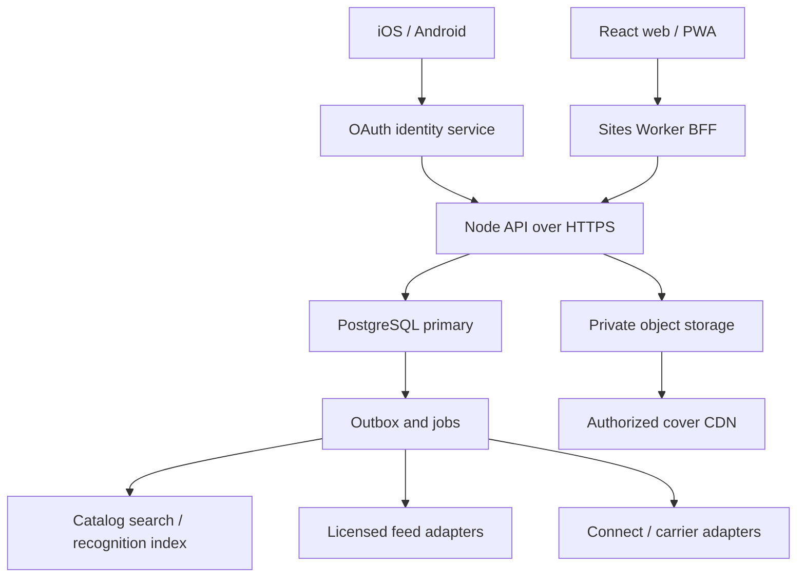

# ComicHuddle production architecture

**Review date: 13 October 2026.** This document specifies the PostgreSQL target and the current engineering candidate. The running Site still uses Cloudflare D1 and R2. The PostgreSQL files are a reviewable companion implementation; no production database migration, commercial data purchase, live payment, or signed native release is established by this document.

The product rule is simple: a directory edition identifies the comic; a collection row identifies one physical copy; a listing identifies the actual copy or copies offered; a dated value describes only its exact comparable. A scanner proposes an identity. The collector confirms it before a new owned copy is saved.

## 1. Delivery boundary and current state

| Capability | Current candidate | Production target or gate |
| --- | --- | --- |
| Hosting and accounts | Private owner Site, React/Tailwind application, managed Worker routes, D1 and R2 | Keep the private audience until the relevant release review; add a separately deployed, authenticated PostgreSQL API |
| Directory | 43 independently entered starter issues; existing numeric IDs must remain resolvable | Licensed and reviewed editions, variants, printings and provider crosswalks; starter records with unconfirmed printing must not become verified exact editions merely through migration |
| Covers | Six authorized US vintage Planet Comics covers, starter IDs 24–29 | An image grant that explicitly covers display, storage, transforms and recognition indexing; modern-cover coverage is not established |
| Values | No current licensed full FMV feed | Authorized sample reconciliation, exact comparable fields, rights expiry, freshness and measured model quality |
| Scan | Automatic suggestions can operate against the six known cover references, followed by directory validation and collector confirmation | A licensed, evaluated broader recognition index; image recognition must not invent an edition, certify a grade, or imply that an unmatched comic is absent from the directory |
| Marketplace | Existing guarded marketplace/commerce candidate; disconnected live checkout | Verified seller onboarding, inventory reservations, payment/refund/transfer reconciliation and staffed dispute operations |
| Native | Six-tab prototype; center camera action opens the website scanner | Actual iOS/Android camera and account journeys, signing and store review; an unsigned export is not physical-device evidence |

Current D1 routes and account data are not silently replaced by the PostgreSQL blueprint. Refer to [TEAM.md](TEAM.md), [RELEASE-READINESS.md](RELEASE-READINESS.md), [DATA-ACCESS-DECISION.md](DATA-ACCESS-DECISION.md) and [INDEPENDENT-FMV-METHOD.md](INDEPENDENT-FMV-METHOD.md) for the existing product, rights and valuation decisions.

The companion code provides the core relational model, guarded canonical merge, exact deal analysis and public response contracts. This document also specifies required deployment work: the Node service and real authentication adapter, deployed database roles, durable job/outbox integration, licensed ingestion, payment/carrier adapters, operational monitoring and recovery. Those designs must not be mistaken for already running integrations.

## 2. Platform topology



The current managed Sites runtime exposes HTTP-based external connections and does not expose raw TCP; each isolate has a 128 MB memory limit. Preserve its `sites()` build integration. Put the `pg` pool and transaction code in a supported Node service; the Worker calls its bounded HTTPS API. Keep large import, embedding and recognition-index jobs outside the BFF. General Cloudflare Workers have a TCP sockets API, but that broader capability does not establish support in this managed Sites environment. [S1]

Keep PostgreSQL private to the API and job services. Require verified TLS, bounded connection pools, request and statement deadlines, cancellation, payload limits and allowlisted upstream origins. Start with one primary in the chosen operator region and managed backups. Add read replicas only when measured read load warrants them; purchase, account authorization and merge decisions must use the primary. Do not use a replica for a just-completed write without an explicit consistency strategy.

The BFF verifies its dispatch-owned visitor identity at the hosted trust boundary. It forwards a short-lived, audience-bound internal assertion to the API, authenticated as the BFF service. The API rejects arbitrary browser-supplied `oai-authenticated-*` headers. It also rejects identity forwarded through an unauthenticated public endpoint. A native client obtains its own production OAuth session and calls the same API; browser handoff does not supply native authentication.

Maintain environment separation: local fixtures, isolated integration database, invited staging, and production each have separate identities, grants, buckets, keys, payment objects and callback URLs. The current private Site cannot serve as an assumed publicly reachable Stripe webhook endpoint.

The framework-neutral [api.ts](../architecture/postgres/api.ts) handlers are reference endpoints, not new live routes:

| Proposed API route | Purpose | Authority |
| --- | --- | --- |
| `GET /api/marketplace/:listingId/deal-analysis` | Public-safe exact comparison; optional under-review preview | Verified member session and controlled valuation role |
| `POST /api/directory/custom` | Create provisional directory identity plus pending review | Verified collector; actor supplied by the server |
| `POST /api/admin/directory-reviews/:reviewId/approve` | Human-reviewed canonical identity approval | Verified admin/moderator and current database membership; accepts no FMV input |
| `POST /api/admin/directory-reviews/:reviewId/merge` | Idempotent version-checked merge | Verified admin/moderator and current database membership |

`authenticate()` is an injected deployment dependency; a mock used in a local test is not a production JWT verifier. Reference mutations already require a trusted configured `publicOrigin`, matching Origin, JSON content type and a bounded actual UTF-8 body, default 16 KiB; invalid/foreign/oversized input fails before SQL. [session.ts](../architecture/postgres/session.ts) whitelists the collector/valuator/moderator roles, sets request context locally, commits deferred constraints, rolls back on error and releases the connection. Wire these handlers only behind the real identity and remaining ingress controls below.

## 3. Authentication, authorization and privacy

Use Authorization Code with PKCE for native and browser account integrations. Validate issuer, signature using an allowlisted algorithm, audience, expiry, not-before and relevant nonce/session binding; use exact registered redirects, state validation and short-lived access tokens. Rotate refresh credentials, invalidate sessions on account restriction, and keep native secrets in OS secure storage. OAuth security guidance supports these choices; the concrete provider and its production configuration remain a deployment decision. [S2]

Resolve the validated external subject to an internal user UUID through a unique issuer/subject crosswalk. Existing Sites visitor IDs are site-scoped; linking a future native/OAuth identity requires proof of both sessions, not an email match. The reference `users.external_subject` must be namespaced unambiguously; add an identity crosswalk when one user can link multiple providers. Never treat email, display name, a query parameter or a request body's `ownerId`, `actorId`, `role`, `isAdmin` or `rightsConfirmed` as proof of authority. Accounts deleted or restricted after session issuance must fail the relevant write checks.

| Database principal | Responsibility | Boundary |
| --- | --- | --- |
| Migration owner | Reviewed schema changes and role grants | No normal HTTP request uses this principal |
| Identity provisioning role | Narrow user/crosswalk creation and lookup after token validation | Separate from migration ownership; cannot assign administrator membership |
| Application role | Owner-filtered reads and allowed mutations | No superuser, ownership or `BYPASSRLS`; no arbitrary SQL endpoint |
| Catalog/value ingestion role | Reviewed canonical metadata and licensed value imports | Cannot read collector addresses, collection notes, messages or payment credentials |
| Moderation function role | Narrow review/merge operation | Restricted execute privileges, fixed trusted search path, actor rechecked against administrator membership |
| Job/payment roles | Their explicit outbox and ledger operations | Separate capabilities; no universal admin key in browser or mobile app |

Within a database transaction, the trusted API sets the verified user UUID in a transaction-local setting used by row policies. This setting is **context, not authentication**: a client allowed to execute arbitrary SQL could set it itself. Never provide that client direct SQL access. Test reset behavior when a pooled connection returns to the pool, fail closed when context is absent, and do not reuse a context across requests. Role setup in the companion implementation must be reviewed against the actual pooler mode.

Enable RLS on private user-owned tables with both read predicates and write checks. Force RLS where appropriate; table owners and privileged roles otherwise bypass it. A public showcase exposes a deliberate projection of opted-in fields, not all columns in the owner's collection row. Separate private collection notes, purchase cost, storage location, contact information, messages, receipts and custody evidence from public directory and marketplace data. PostgreSQL's referential checks can reveal existence through errors despite RLS; return generic unauthorized/not-found errors and avoid exposing raw database diagnostics. [S3]

The production ingress and write routes must enforce actor authorization, strict input schemas, same-origin/CSRF controls for cookie sessions, persistent rate limits, bounded body sizes and object ownership. The reference implements the configured-origin/JSON/streamed-body checks, actor-bound SQL and contract validation. Actual issuer/session verification, cookie configuration, deployment HTTP mounting and persistent rate limits still need production integration. Parameterize SQL. Restricted security-definer functions use qualified objects, a fixed safe `search_path`, explicit administrator checks and restricted execution; a function's elevated role is not a substitute for validating its caller. [S4]

Media keys are opaque and private. Validate decoded file type, dimensions and size; re-encode permitted formats, remove metadata and scan malicious uploads before publication. Signed upload/download grants bind owner, object purpose, byte limit and expiry. User-submitted cover evidence does not automatically become licensed public catalog art. Camera frames remain on device in the current scanner; a future cloud recognizer needs an explicit upload/retention consent and a privacy-preserving default.

## 4. Four PostgreSQL pillars

The full executable definitions belong in the companion [schema.sql](../architecture/postgres/schema.sql), with application contracts in [types.ts](../architecture/postgres/types.ts). Use stable UUIDs for the target model and a migration crosswalk from existing D1 IDs. Do not use a title/issue string or a provider's changing ID as the primary key.

| Pillar | Unit represented | Required invariants |
| --- | --- | --- |
| `Directory_Comics` (`comichuddle.directory_comics`) | One distinguishable published edition | Publisher, series volume, issue display number, format, language, printing and variant identity are explicit; approved metadata and provisional submissions have different statuses; aliases preserve old references |
| `User_Collections` (`comichuddle.user_collections`) | One collector-owned physical object | Non-null directory UUID, owner UUID, per-copy condition and optional certification; separate copies of one edition may have different grades, costs and photos |
| `Marketplace_Listings` (`comichuddle.marketplace_listings`) and `listing_items` | One offer and its exact physical-copy manifest | Non-null directory identity on every line, authoritative seller and physical-copy links, current listing version, item-only ask and currency; a custom marker derives from canonical review status |
| `FMVHistory` (`comichuddle.fmv_history`) | One dated exact valuation observation | Append-only source/value history, exact comparable tuple, positive amount, currency, valuation time, import time, rights grant, source/model version and evidence diagnostics |

Use supporting tables for users, series/publishers, provider crosswalks, source-rights grants, aliases, review evidence, administrative membership, reservations, order snapshots, audit events and a transactional outbox. These do not replace the four pillars; they make their trust and lifecycle explicit.

### Canonical edition identity

Issue numbers are strings: `1`, `1/2`, `0`, `-1`, annuals and publisher suffixes cannot safely be coerced to integers. Store a normalized search key separately from the original display form. Distinguish original editions from facsimiles, reprints, later printings, regional/language editions, direct/newsstand editions and price variants. Record both cover publication date and release date where supplied rather than guessing they are identical.

A cover hash is a candidate lookup key, not a globally unique edition key. An identical-looking cover can belong to a reprint or a different printing. Provider IDs are namespaced and uniquely crosswalked to the internal edition. Preserve provenance per field when combining feeds; conflicting issue metadata requires a review event, not last-write-wins replacement.

The reference schema encodes series identity through publisher/title/start-year and a reviewed unique canonical edition key. Before broader imports, extend or explicitly encode publication format and publisher/series identifiers in that reviewed identity; do not merge a single issue, trade paperback and facsimile through title/issue alone. The richer normalized publisher/series/source-grant model in this blueprint is a rollout requirement where the chosen feed needs it.

First-appearance/key claims retain their own provenance and review state. The companion `directory_character_debuts` distinguishes full appearance, cameo, team/costume and claimed appearances. A collector's claim or an unsupported editorial note is not promoted to a verified historical fact solely because the edition has a canonical UUID.

A custom submission first creates a **non-null provisional directory UUID** and a pending review record. Its physical copy and draft listing can immediately reference that UUID. It never escapes referential integrity through `NULL` or through a made-up canonical ID. Pending items may offer a read-only buyer preview with a clear warning and contact path; active/reserved commerce requires a verified canonical edition. A provisional record is not a claim that the item is counterfeit.

### Physical collections

One save creates one physical-copy UUID; repeated edition saves are permitted because collectors can own multiple copies. Copy condition is separate from catalog metadata. Record Raw as an owner/seller assessment unless independently assessed; a CGC numeric grade is a claim about the certified copy and needs its grading company, label and certificate evidence. A visual scan does not supply a certified grade.

Collector column grants exclude `metadata_verification`; a collector cannot promote their own statement to VERIFIED. Commerce copy writes are limited to disposition. The reference numeric-grade constraint allows one decimal between 0.5 and 10; ingestion must additionally validate the actual grading company's discrete scale and certification evidence. This broad numeric storage check is not a certification validator.

Enforce owner access at the API and RLS layers. A seller cannot attach another person's copy to a listing. Once reserved or sold, immutable identity/condition snapshots preserve what the buyer agreed to; editing a collection note or later merging metadata cannot alter the recorded bargain.

Collection values use each owned copy's exact eligible comparable. Show priced-copy subtotal and coverage when some copies are unknown; do not multiply a directory card's Raw Near Mint/CGC 9.8 guide value across every copy or substitute purchase cost for FMV.

### Listings and inventory

A single-comic listing still has a one-line manifest. A lot has one line per physical copy and exact identity/grade fields per line. Use consistent composite foreign keys or equivalent database-verified constraints to prevent a listing line from claiming a different edition or owner than its copy. Do not let public JSON set a verified status, seller ownership or the warning flag.

Enforce one live reservation/listing claim per physical copy. Reserve all lot copies together in deterministic UUID order, recheck seller eligibility and the listing version, write a durable reservation/order snapshot and commit before creating an external payment operation. The buyer's click provides only listing ID and expected version; the server reads the price and manifest. A sold or changed listing returns a conflict that prompts refresh.

Lock and version checks protect competing purchase/merge/update transactions; they are not validated by a TypeScript-only build. PostgreSQL row locks block conflicting writers, and serializable transactions can fail and require whole-transaction retries. Use bounded retry for serialization failures and deadlocks, and reuse the application idempotency identity. Never hold a transaction open while a buyer completes checkout or while a provider request runs. [S5, S6]

### FMV history and provenance

Match the complete comparable identity:

```text
canonical edition + variant/printing + mode + grading company + grade
+ label class + premium attributes + currency + valuation basis
```

For Raw, company/label must preserve the raw semantics. For certified copies, Universal, Signature Series, Qualified, Restored and Conserved are separate pools. The schema's `comparable_attributes_key` matches exactly between a physical copy and its quote. Copy keys default to `UNKNOWN`, which remains unpriced. `STANDARD` identifies supported raw copies; `CGC_WHITE_NO_PREMIUM` identifies the supported CGC Universal/no-premium comparison with white pages. Premium labels require a distinct reviewed key. Signer/restoration/page-quality/pedigree taxonomy and evidence belong to reviewed ingestion; an arbitrary key string is not verification. Unknown fields cannot silently match the standard/no-premium pool.

Reject zero, negative, nonfinite, out-of-cap, future-dated or mismatched quotes. Preserve date and currency; do not convert a missing USD quote with an unversioned exchange rate. Never replace Raw with CGC 9.8, substitute 9.6 for 9.8, interpolate missing grades, or relabel a provider's LOW/MID/HIGH buying guidance as exact numeric-grade FMV.

Append new observations rather than overwriting history. Current display selects an eligible exact observation using its source valuation date, grant validity and the configured freshness rule. A recent import timestamp does not make an old quote current. A dated auction result remains a historical sale; it is not a current estimate. A stale or missing quote is unknown, not `$0`.

`directory_comics_fmv` supplies convenient **live view fields**, rather than editable prices on the edition row:

| View field | Exact USD comparable |
| --- | --- |
| `raw_fmv_cents` | Raw Near Mint, `STANDARD` |
| `cgc_9_8_fmv_cents` | CGC 9.8 Universal, `CGC_WHITE_NO_PREMIUM` |
| `cgc_9_6_fmv_cents` | CGC 9.6 Universal, `CGC_WHITE_NO_PREMIUM` |
| `cgc_9_0_fmv_cents` | CGC 9.0 Universal, `CGC_WHITE_NO_PREMIUM` |

Every field remains null when no eligible quote exists. Other conditions, labels, premium categories and currencies use their own normalized rows rather than borrowing these values.

## 5. Deal analysis and honest badges

The server owns `analyzeMarketplaceDeal(client, listingId, { asOf })`. It loads the canonical listing, its copy manifest, exact current licensed quotes and warning status from the database. It accepts neither an FMV nor a seller-provided risk score. The complete implementation is [analyzer.ts](../architecture/postgres/analyzer.ts); its `schemaVersion: "1.0"` and `modelVersion: "price-data-heuristic-v1"` accompany the result. The internal result may contain restricted evidence. `publicDealAnalysis()` removes private proof URIs, proof hashes and license references and exposes only approved attribution, dates, sample count and method.

Use the exported functions inside an authenticated, transaction-scoped API operation; this excerpt does not create or authenticate a database connection:

```ts
import { analyzeMarketplaceDeal, publicDealAnalysis } from "./analyzer.js";

const result = await analyzeMarketplaceDeal(client, listingId, {
  asOf: new Date(), // server clock; never an arbitrary buyer-supplied date
});
const buyerDto = publicDealAnalysis(result);
return Response.json(buyerDto, {
  headers: { "Cache-Control": "private, no-store" },
});
```

For a positive exact item-only FMV, use the following arithmetic in the quote's currency and amount basis:

```text
variancePercent = 100 × (askingItemPrice − exactFMV) / exactFMV
negative variance → ask is below the matched estimate
positive variance → ask is above the matched estimate
```

Perform amount arithmetic in integer minor units within explicitly validated caps. Preserve full internal precision for threshold decisions; round only presentation. The companion v1 thresholds are ask ≤85% of the full exact baseline for Below Market, ask ≥115% for Overpriced, and Fair between those boundaries. These are explicit product rules, not statistically calibrated recommendations. A change in shipping, tax, premium or lot allocation must not quietly change an item-only comparison.

The API serializes cents as integer decimal strings and uses `BigInt` for money and threshold arithmetic. `baselineCents: null` and `variancePercent: null` represent an unavailable whole-listing comparison. If there are no priced lines, the empty subtotal may be `"0"`; the UI must show FMV unavailable rather than treating that subtotal as a zero-dollar valuation.

| Assessment state | Buyer sees | Server behavior |
| --- | --- | --- |
| All lines have exact, licensed and current coverage | Below Market, Fair or Overpriced using the versioned analyzer thresholds; quote date/source | Listing-level variance is permitted |
| A lot has partial coverage | Priced-copy subtotal, `pricedCount / totalCount`, per-line reasons | Listing-level FMV/variance/rating is Unknown; no extrapolation to the whole lot |
| Missing, stale, expired-rights, mismatched or malformed quote | FMV unavailable or the precise data limitation | No usable FMV; preserve unknown status |
| Provisional custom identity | Unverified custom item / awaiting admin review | No official FMV, active checkout or qualifying deal badge |
| Very low ask versus eligible exact FMV | Below Market plus a caution explaining the extreme discount | More scrutiny is required; an unusually low ask is not automatic proof of fraud |

`DealRiskScore` is a **price/data caution heuristic**, not a calibrated probability of fraud, seller trust, authenticity or financial loss. It must include its component reasons and rule version. A result with unknown FMV or provisional identity cannot become a zero-risk deal merely because a denominator is absent. Unknown/partial coverage has a conservative caution floor of 60; a complete baseline with ask below 50% triggers a score of at least 90 and the extreme-discount warning. The UI still displays data gaps and an Unknown rating, and does not describe a score as a probability.

The current piecewise rule is reproducible:

```text
base = 0 for Fair, 20 for Below Market, 30 for Overpriced, 60 for Unknown
score = max(base,
            90 when ask < 50% of a complete baseline,
            10 when copy metadata is seller-declared,
            60 when a line is custom or the listing is under review)
```

A score of zero therefore means no caution triggered by this narrow rule set. It does not mean zero transaction risk. Any later change to these rules increments `modelVersion` and requires fresh validation.

The companion analyzer emits a position badge: Below Market, Fair, Overpriced or Unknown. The reusable reference [DealWarningBadge.tsx](../architecture/postgres/ui/DealWarningBadge.tsx) implements the requested buyer security cue as an explanatory price/data warning, using only the public DTO. When connected to the future authenticated API, it displays Below FMV, Fair market value, Overpriced or FMV unavailable, with the caution score and warnings. It rechecks full coverage, custom status and quote timestamps and returns to Unknown when the evidence expires. A price comparison cannot certify a seller or comic, promise delivery/refund coverage or establish payment protection; the component therefore makes no Secure Deal guarantee. Eligibility is recalculated server-side; CSS, an icon and client-provided booleans do not establish security.

Store the assessment's listing version, manifest hash, quote IDs, as-of time, currency and model version for reproducibility. A newer quote or listing edit invalidates the previous result. At checkout, reserve against the authoritative listing and create a fresh immutable order snapshot; a badge is not authorization to purchase.

## 6. React/Tailwind directory card and collection flow

The reusable React/Tailwind source is [ComicProductCard.tsx](../architecture/postgres/ui/ComicProductCard.tsx), used by the live [shared-directory.tsx](../app/shared-directory.tsx) wrapper. It uses semantic buttons, a contained cover and a metadata fallback where cover rights are missing. Its Raw and CGC 9.8 toggles select different quote comparables: Raw Near Mint with `STANDARD`, or CGC 9.8 Universal with white pages and `CGC_WHITE_NO_PREMIUM`, both in USD. They do not relabel one amount or claim that the raw book will grade 9.8. Quote guards use the SQL label `UNIVERSAL`; ownership forms preserve their display labels and map them explicitly through the collection adapter.

The card validates edition ID, positive integer cents within its display cap, currency, rights, dates, source and the selected comparable tuple before displaying an amount. It shows the mode/grade/label and source date next to the value. No eligible quote produces Value unavailable or the current deferred-feed label; it never produces a fictional amount. A production data wrapper must additionally distinguish loading and request failure from a data gap. If a future Raw provider requires a numeric condition, implement a matching numeric contract explicitly. Late responses cannot overwrite a newer selection.

**Add to collection** opens a modal preselected with the issue and saves **one physical copy**. The current modal supports Raw with owner-stated condition or CGC with grade, label and certification number, plus optional purchase price/date and private notes. It preserves the request UUID across a retry of the same submission, blocks duplicate pending saves, and offers Add another copy for an already owned issue. The callback's server validates the directory link and private fields, writes idempotently, and acknowledges what was saved. Anonymous users retain their pending intent through sign-in and review it before submitting. The PostgreSQL schema can represent other grading companies; that does not establish UI or feed support for them.

The live callback continues through [hub.tsx](../app/hub.tsx) and the current D1 vault. The PostgreSQL reference [collection-adapter.ts](../architecture/postgres/ui/collection-adapter.ts) provides `collectionColumns()` and `saveOwnedCopy()` for a future authenticated transaction. It maps raw/label representations, resolves aliases and uses the request UUID as the copy ID; an exact replay succeeds and a different payload conflicts. It leaves comparison metadata `UNKNOWN` and never infers VERIFIED certification or a premium category from the form. Private notes are stored with a 500-character bound and excluded from public facts and order-copy projections. The ownership editor uses the same validated form helper so display and structured fields stay consistent.

**Buy this exact issue** opens the marketplace with the stable directory ID. In the PostgreSQL target that ID denotes the specific edition/variant/printing. Preserve the identity filter across pagination and empty states. A generic title search is not evidence of an exact match. The FMV display toggle is guide context; each listing still shows its own actual copy grade/condition. If the buyer explicitly chooses a grade/company/label search filter, preserve those constraints as well. If no eligible copy exists, say so and offer an explicit broader-search action; do not silently display another printing as exact. Clicking a listing requires review of that copy's price and terms.

Focus enters the modal, remains within it, and returns to the triggering control on close. Support escape, keyboard selection, touch, reduced motion and screen-reader status messages. Responsive cards must avoid clipping issue numbers, prices and action labels. UI checks are recorded in the verification section; physical browser/device acceptance remains separate.

## 7. Camera scanning and broader recognition

The center camera action opens the scanner while preserving the six primary navigation destinations. It is an action button, not a seventh section tab. The current native prototype explicitly hands off to the website scanner through its production URL; it does not contain an Expo camera or native frame recognition engine.

### Current authorized six-cover engine

The web candidate compares local camera frames or a chosen photo with Planet Comics #12, #21, #27, #42, #53 and #55, mapped to starter IDs 24–29. [cover-recognition.ts](../lib/cover-recognition.ts) uses spatial luminance/chroma/edge fingerprints at an 18×26 grid, a distance cutoff of 0.14 and a runner-up gap of at least 0.07. These are heuristic acceptance settings, not calibrated accuracy/confidence percentages. Reference provenance and hashes are in [cover-index.json](../public/recognition/cover-index.json), generated reproducibly from the existing authorized assets.

For live camera suggestions, three consecutive qualifying frames must be separated by at least 300 ms and span at least 700 ms. Frames are bounded to a longest side of 640 pixels, and the next poll waits at least 450 ms after the preceding analysis finishes. The app resolves the proposed catalog ID and title/issue/year/publisher against the directory before presenting the automatic result, then validates again before the explicit collect/view action. It handles revoked/missing catalog records and delayed responses rather than saving the fingerprint's ID blindly. Source: [scan-comic.tsx](../app/scan-comic.tsx).

Only the collector's **Confirm & add** action may open the copy form/save path. Results include title, issue, year, publisher and unresolved edition/printing warnings. A preview, a cover similarity number or a successful ID fetch does not authenticate a physical object. Reprints with similar art can remain ambiguous.

Camera startup requires HTTPS and an explicit user permission action, requests the rear-facing camera and captures no audio. Permission denial, unsupported APIs, glare, slow startup and unreadable frames have actionable retry/photo/manual-search states. Stop tracks, cancel loops and invalidate old recognition results on close, retake, navigation and unmount. The current implementation also stops work when the page becomes hidden and requires fresh consensus when resuming. Browser capture constraints are requests and device support varies; actual camera behavior requires supported-device testing. [S7]

The six-reference index is intentionally small. An unsuccessful match means **not recognized within the current scan coverage**, not “not in the database.” The scan can then offer directory search and custom submission, without asserting global absence. Even a successfully completed exact title/issue search with zero results means only that the currently connected directory returned no exact result. No frame is uploaded by the local recognizer.

### Licensed production recognition pipeline

| Step | Output | Guardrail |
| --- | --- | --- |
| Capture and quality gate | Cropped, perspective-corrected cover candidate; blur/glare/occlusion diagnostics | Request another frame when quality is poor; minimize upload and retention |
| Barcode/OCR | Observed text and code, with location/confidence | Crosswalk UPC/EAN plus supplemental issue/variant/printing digits; partial codes and OCR are candidate evidence |
| Visual retrieval | Top candidate editions from licensed fingerprints/embeddings | A retrieval score is similarity, not a correctness probability; retrieval index respects license scope |
| Metadata reconciliation | Candidates constrained by title, publisher, year, issue, printing and variant | Conflicting barcode, text and visual evidence produces ambiguity rather than forced identification |
| Calibration and decision | Candidate rank, calibrated supported confidence, rejection reason and model/index version | Measure false matches on held-out originals, facsimiles, variants, slab glare, rotations and unseen comics; select thresholds from measured errors |
| Collector confirmation | Confirmed canonical UUID or provisional submission | Show alternatives and require confirmation before creating ownership |

A licensed embedding/fingerprint index can live beside PostgreSQL or in a dedicated search service. Keep identity, grants and review states authoritative in PostgreSQL; a vector database cannot certify catalog truth. Use a documented recognition adapter contract with cancellation, request ID, candidate UUIDs, index coverage/version and evidence. Do not assume that a consumer app offers a commercial recognition API.

ComicSnap's seller-authored App Store description advertises photo identification, values, condition suggestions and collection organization. It is a useful public UX reference; that description does not establish its recognition accuracy, a reusable API, a data feed or permission to copy its catalog/images. ComicHuddle's design keeps recognition, catalog confirmation, physical condition and licensed valuation as separately verifiable operations. [S8]

## 8. Custom entry review and safe canonical merge

Show this warning whenever a provisional item appears in a copy form, review preview or draft listing: **“Unverified custom item — awaiting directory review. Identity and market value have not been confirmed.”** Keep its review status visible. A missing match, user-created entry or statistical price flag is a reason for review, not a fraud verdict.

The queue presents submitted metadata, supporting images/receipts with private access, proposed duplicates, license status, reason codes and the current record version. Administrators verify evidence and exact edition identity, request information, reject abusive/unsupported submissions, verify a new canonical edition, or merge into an existing verified edition. Document the human actor, evidence references, decision and appeal/contact path. Administrators may retain a clearly typed `EDITORIAL_ESTIMATE` observation in the history for audit and disclose it as editorial guidance where rights permit. It is not an official `SALE_BASELINE`, cannot qualify as FMV, and cannot generate an official-value badge.

That is the required administration workflow. The reference implements custom creation, identity approval and merge handlers; the schema persists REJECTED and excludes rejected entries from buyer previews. A rejection/request-information RPC and the PostgreSQL queue frontend still require integration. Do not expose direct status-column editing as a substitute for an audited decision operation.

The canonical merge must be one database transaction with a stable idempotency request UUID:

1. Authenticate the actor and check current administrator membership inside the protected operation.
2. Lock review/source/target and affected live inventory in a consistent order. Check expected source/target versions and pending review status. Reject self-merge, noncanonical targets, cycles and incompatible edition evidence.
3. Resolve aliases, retain the source UUID as a permanent alias/tombstone, and remap physical copies and mutable listing lines to the target. Recompute the authoritative custom flag; do not accept the request body's chosen flag.
4. Keep immutable settled-order/sale snapshots unchanged. Preserve original submitted metadata and merge audit history. FMV cannot be moved onto a target without compatible exact identity and reviewed rights; the source's arbitrary editorial estimate never becomes the target's official FMV.
5. Record review outcome, increment versions, and write a committed outbox event for search/cache invalidation. Store the merge result against the idempotency request so a retry returns the same outcome.

Optimistic version checks avoid approving stale review pages, and locks stop concurrent reservations/merges from mutating the same copy inconsistently. A repeated request with a changed source/target payload conflicts rather than executing another operation. A merge does not create a second owned copy or sell inventory. Lot lines resolve individually; one reviewed item does not approve every line in a lot.

The implementation and administrative adapter are in [moderation.ts](../architecture/postgres/moderation.ts) and [schema.sql](../architecture/postgres/schema.sql). Execute permission and actual deployed API authentication remain rollout gates even when isolated SQL tests pass.

`resolve_directory_id(uuid)` and the parameterized `resolveDirectoryId()` adapter preserve links through a former custom UUID to its canonical target. A stranger's unreviewed provisional identity does not become visible through this resolver. During migration, legacy numeric/provider IDs first use their reviewed crosswalk; they are not passed into a UUID resolver or rematched from editable title strings.

## 9. Catalog, value, search and job operations

Source agreements must separately cover bibliography, editorial/key notes, cover art, automated recognition, value ingestion, derivative estimates, public/free/paid web/native display, caching, attribution, territories and removal on expiry. A consumer subscription, a publicly reachable image or a provider account does not supply those rights. Existing procurement findings remain in [DATA-ACCESS-DECISION.md](DATA-ACCESS-DECISION.md).

Maintain one operator-managed shared catalog. Collectors search ComicHuddle's internal directory and must not be required to provide third-party catalog credentials. Provider keys and grant references remain in server-managed configuration and reviewed records.

The agreement must permit the chosen history/snapshot retention. Append-only integrity does not override a supplier's removal requirements: where deletion or redaction is required, implement an audited administrative purge design before ingesting that source. Preserve permitted identity/audit records and owned-copy links without retaining prohibited payloads.

The ingestion adapter stages a bounded batch, validates provider identity and schema, verifies grant scope for each record, crosswalks editions and rejects mismatched/ambiguous values. Import source payload hashes and batch IDs for audit; retain only what the agreement permits. Publish a reviewed batch atomically, then use an outbox event to refresh allowed search/CDN projections. Rate limits, backoff, circuit breakers and provider diagnostics prevent an upstream outage from affecting private collection writes.

The reference ingestion role can read supplier policy and append quotes; it cannot create its own display license or verification grant. Active administrator/moderator source-policy writes are separately authorized, and VERIFIED review evidence is attributed to the actual transaction actor. Attribution/method defaults remain neutral until supplied. Database flags record an approved agreement and review; setting a flag does not itself create legal rights.

At the initial scale, use PostgreSQL indexed exact keys, text search and cursor pagination for directory search. PostgreSQL supports GIN indexes for text search. Measure title/issue ambiguity and query plans before adding a separate search system; a search hit must still resolve to the authoritative edition. [S9]

Outbox consumers claim bounded work with leases, retry with jitter, record attempts, and move exhausted work to an operator-reviewed dead-letter state. Consumers deduplicate event IDs and support replay; delivery is at least once, not a claim of exactly-once network execution. A collection/listing/merge write and its corresponding outbox row must commit together. Do not publish an event before its transaction commits or assume a best-effort HTTP call makes a durable job.

Public CDN caches hold only license-approved catalog projections and covers. Private account, collection, message, moderation evidence and payment responses use `private, no-store`. Catalog changes and rights revocation invalidate both origin projections and cache tags. Value eligibility is checked at response time as well as during import, so expiry does not depend solely on a scheduled job. Configure native/offline storage expiry consistently with the grant.

Refresh quotas and feed schedules follow the actual provider agreement. Alert on stale last-success timestamps, revoked rights, quote coverage regression, rejected batch spikes and unexpected deletion/crosswalk volume. The operator needs a kill switch for a source or dataset that removes current display without deleting collector-owned records.

## 10. Payments and marketplace protection

Use approved Stripe Connect onboarding and a reviewed charges/transfers model. Hosted processor collection keeps card data out of ComicHuddle. Verify seller account/capability status server-side before an order can progress. The existing business/policy documents describe the desired protection operations; they are not evidence that live protection is active.

The server reserves inventory and creates an immutable order manifest before requesting a checkout/payment object. Record unique processor references and the application idempotency key. A redirect or client success flag cannot authorize fulfillment. Verify raw-body webhook signatures, persist a unique event receipt, retrieve/check the bound processor object, and handle duplicate, delayed and out-of-order delivery through the durable state machine. [S10]

Payment capture, platform balance, transfer to a connected seller and payout to the seller's bank are different operations. Stripe documents separate charges/transfers and that a charge refund does not automatically reverse a seller transfer. Manual payouts are not regulated escrow; do not market a risk hold as an escrow account. A processor idempotency key complements but does not replace the permanent application operation ledger. [S11, S12, S13]

Risk holds require processor-approved timing, clear seller/buyer terms, lawful funds handling, support and refund/dispute liquidity. Their release needs verified carrier or human-reviewed evidence, the policy version agreed at checkout, and a recheck for open claims. Delivery establishes arrival evidence, not authentic grade or seller honesty. Keep refund, transfer reversal, dispute, tax adjustment and fee treatment as distinct linked ledger actions, with daily balance reconciliation and alerts for failures.

Before live funds, finish operator/processor approval, seller onboarding, applicable tax/accounting, consumer and auction terms, claims handling, jurisdictional funds-flow review, privacy/retention disclosures and staffed incident/support coverage. Refer to [BUYER-PROTECTION-AND-PLATFORM.md](BUYER-PROTECTION-AND-PLATFORM.md), [COMMERCE-PROTECTION-POLICY.md](COMMERCE-PROTECTION-POLICY.md), [PAYMENT-AUDIT.md](PAYMENT-AUDIT.md) and [STRIPE-SANDBOX-SETUP.md](STRIPE-SANDBOX-SETUP.md). No sandbox or simulated outcome proves live approval.

## 11. Rollout, recovery and operating acceptance

Migrate through a separate staging database first. Export D1 with integrity counts and checksums, define immutable old-ID→UUID maps, reconcile every collection/listing/social reference, and retain unresolved starter editions as provisional/unconfirmed. Imported values must retain provenance and may enter current display only after fresh rights/exact-identity checks. The current D1 value contract uses numeric Raw grades; the reference PostgreSQL contract uses named raw conditions. A reviewed adapter must preserve the provider's semantics, or keep the values unpriced; do not silently map one into the other. Backfill in resumable batches with unique import identities.

Use shadow **reads** to compare safe responses and reconcile canonical identities, totals and privacy filters. Do not independently write the same collection or payment mutation to D1 and PostgreSQL. If zero-downtime cutover is required, implement one durable replication/write-order design and demonstrate restart/replay recovery first. A controlled write pause and reconciliation is acceptable for the small private candidate.

Before switching, run migration and role checks, restore a backup into a separate environment, reconcile all rows and identities, validate authorization with separate accounts, and exercise the actual connection pool/HTTP bridge. Switch a bounded invited cohort first, then expand only after the named operator reviews evidence. Record schema version, source commit, deployed artifacts, rights versions and rollback conditions.

After PostgreSQL accepts new writes, reverting only the frontend to an old D1 view is not a safe data rollback. Freeze affected writes, preserve the durable journal, restore/replay or reconcile the authoritative store, and verify buyer/seller ownership before resuming. Never replay a payment provider mutation blindly during recovery.

| Area | Required production evidence |
| --- | --- |
| Service | Structured request/trace IDs; errors and p50/p95/p99 latency by endpoint; connection saturation, timeouts and lock waits; tested health and incident alerts |
| Privacy | Cross-account positive/negative API tests, spoofed identity/role tests, object-media authorization and public-projection review |
| Inventory | Separate-connection purchase/reservation/merge races, expiry/retry recovery and no duplicate physical-copy sale |
| FMV | Exact licensed sample agreement, malformed/stale/expired/variant/grade/currency rejection, partial lot behavior, quote lineage and measured calibration |
| Recognition | Holdout originals/reprints/variants/unseen covers, glare/blur/rotation conditions, calibrated false-match measurements and physical-device frame/lifecycle tests |
| Commerce | Actual processor sandbox objects reconciled to app state; invalid/duplicate/out-of-order webhooks, refund/reversal/dispute failure and reserve/release races |
| Performance | Representative catalog size, a documented peak-load model, measured query plans, memory/pool budgets and controlled failure/load tests |
| Recovery | Encrypted backups plus retained WAL/PITR, independent object-store recovery, isolated restore drill, reconciliation and measured restore time |

Proposed initial service targets are p95 under 500 ms for indexed catalog/deal reads and under one second for ordinary owned-copy writes, excluding provider interaction. Proposed recovery objectives are RPO ≤15 minutes and RTO ≤4 hours. These are acceptance targets, not measured promises; select plans and prove them with load and restore drills. PostgreSQL PITR requires a usable base backup and the required continuous WAL archive, not only a nightly logical export. [S14]

Record privacy-safe logs: IDs and reason codes rather than card data, raw tokens, addresses, private photos or messages. Use server-managed secrets for provider keys, bridge signing keys and webhook secrets; rotate and redact them, with separate production/staging values. Document incident owners, rollback authority, data-retention/deletion, report/appeal handling and operator access review. Schema, UI and confidence wording changes must carry versioned release notes.

## 12. Verification record and remaining limits

Independent QA's final frozen aggregate exited **0**, ending with `Automated web readiness checks passed`. Exact results, repaired defects, evidence hashes and limits are in [SCAN-ARCHITECTURE-QA.md](SCAN-ARCHITECTURE-QA.md); the aggregate output is [scan-architecture-readiness.log](evidence/scan-architecture-readiness.log).

| Executed scope | Passed named groups/cases | What the evidence establishes |
| --- | ---: | --- |
| Web/app/D1 suites | 676 | 626 retained baseline groups, four new sketch/collection/scan journeys and 46 scan/dock/card groups |
| Reference TypeScript unit tests | 13 | Versioned price rules, unknown/partial coverage, public projection and request/session contracts |
| Actual local PostgreSQL WASM | 60 | Three engine/environment cases, 30 SQL/domain cases, 27 restricted-role/HTTP/SQL-adapter cases |
| **Node aggregate** | **749** | All the preceding named Node groups passed; no failures |
| Separate Python checks | 9 | Reported separately from the Node total |
| Native handlers and geometry | 16 + 7 | Isolated handler groups and seven viewport/cover/dock geometry cases; strict TypeScript and unsigned web/all-platform exports also passed |

The new web groups comprise 15 pixel-recognition groups, 12 controlled scanner lifecycle groups, four center-dock groups and 15 card/badge groups. The current sketch/app/D1 suite passed 45 groups, including the actual card→directory→hub→D1 retry/private-projection path and JPEG→directory D1→explicit confirmation→vault path. These are controlled application/database journeys; media, browser hooks and authentication are test adapters.

The exact final aggregate invocation, from the repository root, was:

```sh
PGLITE_MODULE=/workspace/scratch/comichuddle-pg-qa/node_modules/@electric-sql/pglite/dist/index.js \
  node checks/run-readiness.mjs > project/evidence/scan-architecture-readiness.log 2>&1
```

Network/privacy/dialog/query-budget, TypeScript and deterministic recognition-index checks also passed; they are not counted as additional named cases. A SQL fixture, a simulated payment event, a compiler/build and an unsigned export establish different things and must not be combined into a “fully tested production” claim.

The isolated `@electric-sql/pglite` 0.5.9 engine **reports PostgreSQL 18.6** and executed real SQL, trigger, nonsuperuser role/RLS and handler/adapter integration checks. It has one backend. Separate-connection MVCC/locking, deployed server authentication and production restore readiness remain untested. A separate native PostgreSQL 18.4 binary ran `--version`, but its server could not start under this environment's UID mapping; that is not a successful server/concurrency test.

Genuine physical browser/device, production OAuth, supplier and payment executions are **0**. Real camera/permission behavior, representative physical-comic accuracy, signed native authentication, live processor/carrier evidence, contracted modern recognition/catalog coverage and the production PostgreSQL cutover remain unverified. Native exports are unsigned web/Hermes bundles, not APK/AAB/IPA files or store releases. The browser/device and server-concurrency acceptance plans are prepared but unrun. No provider, payment or device success is inferred from fixtures.

## 13. Official source record

All public sources below were accessed on **13 October 2026**. They establish documented mechanisms, not a license, configured account or completed production test. Implementation thresholds and service targets in this document are ComicHuddle choices.

| Ref | Primary source | Supports |
| --- | --- | --- |
| S1 | [Cloudflare Workers TCP sockets](https://developers.cloudflare.com/workers/runtime-apis/tcp-sockets/) | General Workers capability, distinguished from this managed Sites HTTP-only deployment contract; the lead verified the current Sites runtime instruction in `skill://plugin_connector_1p_689987207de08191979cf68eca2941c6/sites/SKILL.md` |
| S2 | [RFC 9700: OAuth 2.0 Security Best Current Practice](https://www.rfc-editor.org/rfc/rfc9700.html) | OAuth flow, redirect and token security |
| S3 | [PostgreSQL row security](https://www.postgresql.org/docs/current/ddl-rowsecurity.html) | Owner/privileged-role bypass, policy semantics and referential-check caveats |
| S4 | [PostgreSQL CREATE FUNCTION](https://www.postgresql.org/docs/current/sql-createfunction.html) | Safe security-definer search path and execution privileges |
| S5 | [PostgreSQL explicit locking](https://www.postgresql.org/docs/current/explicit-locking.html) | Row locking, lock lifetimes and deadlock behavior |
| S6 | [PostgreSQL transaction isolation](https://www.postgresql.org/docs/current/transaction-iso.html) | Isolation and whole-transaction serialization retry requirements |
| S7 | [W3C Media Capture and Streams](https://w3c.github.io/mediacapture-main/) | Browser camera permission, constraints and capture lifecycle |
| S8 | [ComicSnap seller-authored App Store listing](https://apps.apple.com/us/app/comicsnap-identify-comic-book/id6752642383) | Publicly advertised UX features only; no third-party API or licensing assumption |
| S9 | [PostgreSQL text search indexes](https://www.postgresql.org/docs/current/textsearch-indexes.html) | Indexed catalog-search option |
| S10 | [Stripe webhooks](https://docs.stripe.com/webhooks) | Signature verification and event delivery behavior |
| S11 | [Stripe separate charges and transfers](https://docs.stripe.com/connect/separate-charges-and-transfers) | Charge/transfer separation and refund/reversal responsibilities |
| S12 | [Stripe manual payouts](https://docs.stripe.com/connect/manual-payouts) | Payout distinction, timing and escrow limitation |
| S13 | [Stripe idempotent requests](https://docs.stripe.com/api/idempotent_requests) | Provider idempotency behavior alongside the durable app ledger |
| S14 | [PostgreSQL continuous archiving and PITR](https://www.postgresql.org/docs/current/continuous-archiving.html) | Base-backup and WAL recovery requirements |

