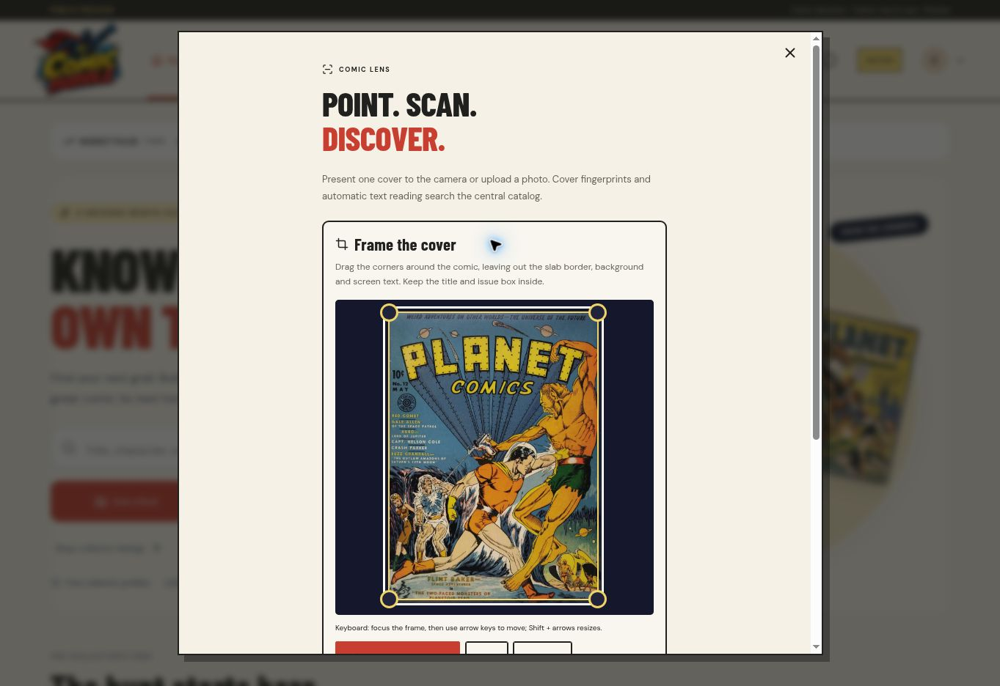
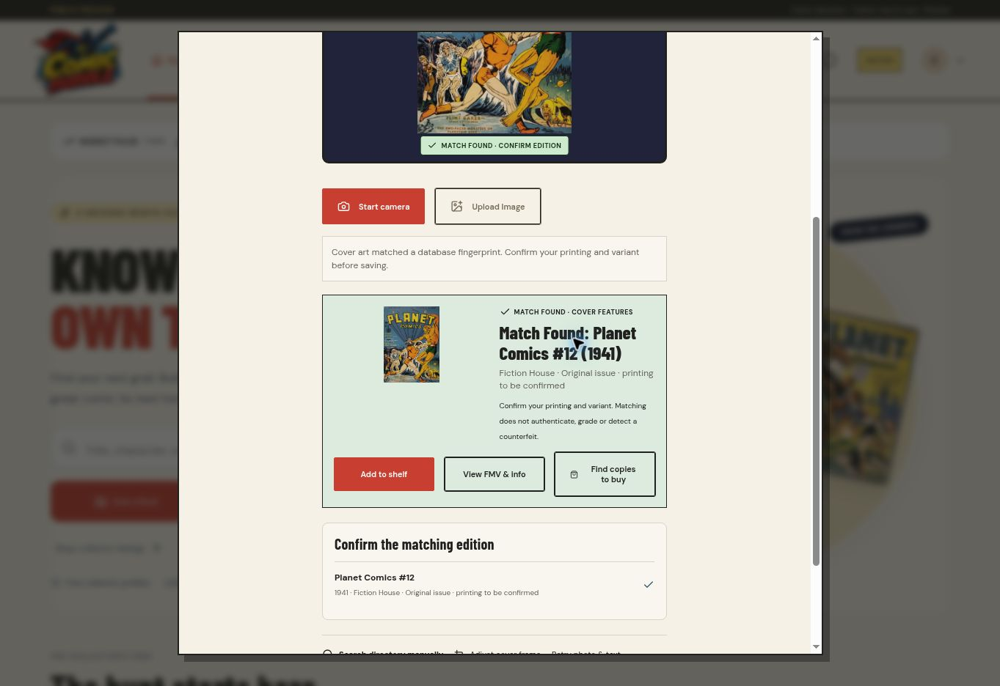

# ComicHuddle scanner and cover continuation

## Deployed result

| Field | Observed result |
| --- | --- |
| Public URL | https://comichuddle-abdul-aziz-akhtars-projects.vercel.app/ |
| Target / status | Production / READY |
| Runtime commit | `cf14a57` |
| Deployment | `dpl_H9zFaHnmK85QAV343uczexRYwSTF` |
| Immutable URL | https://comichuddle-3u6i7vi35-abdul-aziz-akhtars-projects.vercel.app |
| Framework | Next.js 16.4.0 |
| Cloud build duration | 2 minutes, as reported by Vercel |

## Completed changes

- Added **Adjust cover frame** to Comic Lens. Pointer handles and keyboard controls isolate a cover from screen text, a slab border or background. Cropping happens on the device; applying a crop restarts the existing database/OCR recognition flow. It does not add the user's photo to the catalog or reference index.
- Preserved successful OCR catalog searches when another query fails. A partial failed search cannot establish that a comic is missing. OCR no longer automatically selects an edition when the returned search is incomplete, multiple editions remain, or the issue-number signal is only an unanchored digit. Users can choose the matching edition.
- Fixed a native-cover edge case: when a partial `gcd_cover` import lacks a row for an issue, an existing exact, attributed saved reference survives. Actual native deletion/restriction flags still take precedence. A cover-query failure still hides uncertain artwork while retaining the comic metadata.
- Added independent, bounded, read-only cover diagnostics for authorized deployment maintenance. These diagnostics need no migration or reference re-index.

## Fresh RDS findings

The Vercel build environment reached AWS RDS over validated TLS. Local workspace access still fails DNS resolution with `EAI_AGAIN`; the RDS result below comes from the working deployment environment, not an inferred local connection.

At **2026-10-15T06:02:09.098Z**, the native coverage refresh counted **2,620,274 accessible issues**, including **2,620,231 GCD-linked records**. This describes the loaded snapshot and retained additions, not a claim of complete worldwide catalog coverage. Visitor requests use the saved scalar count, not repeated full-table counts.

At **2026-10-15T06:02:11.127Z**, the database contained **233,455 series** and **17,725 publishers**. The native view retains LEFT JOINs for series and publisher. **`gcd.gcd_cover` remains absent.** Therefore there are no native cover IDs or image columns available to join for the uncovered issues. This is a missing source-table dependency, not a demonstrated browser CORS defect.

The saved directory reports **2,094 cover references**, not 2,094 newly verified downloadable files. The visual feature index still has **six** usable locally stored reference covers. No external artwork was fetched in this continuation.

| Requested book | Exact identity | Remaining cover state |
| --- | --- | --- |
| Amazing Fantasy #15 (1962) | GCD 17099 / app 4000017099 | No saved exact cover reference; no native cover table. |
| Amazing Spider-Man #300 (1988), Direct | GCD 44451 / app 4000044451 | A saved exact GCD CDN reference exists. The preceding browser pass could not display it; the prior source-host diagnostic returned Cloudflare 1010. The source host was not re-probed or bypassed in this continuation. |
| Marvel Super-Heroes Secret Wars #1 (1984), Direct | GCD 76314 / app 4000076314 | Live API returned the correct title, number, year and publisher, but no cover reference. |

To populate these missing images, import the matching `gcd_cover` metadata or an authorized exact issue-to-cover export, retaining source IDs, restriction/deletion flags and attribution. Native cover reads detect the table when it becomes available. Valid native `issue_id` indexing and permitted source-host image access are also needed. Bibliographic metadata licensing does not automatically grant artwork rights; guessed issue-ID filenames are not a substitute for cover IDs.

## Scanner result and remaining dependency

In the live browser, the framing editor changed the reference photo's width and height to 99% using keyboard controls. **Scan framed cover** returned **“Match Found: Planet Comics #12 (1941)”** through database cover features. Shelf, information and buy actions were rendered. This confirms the framing-to-recognition boundary for that indexed cover.

**Secret Wars recognition is not declared fixed.** Its catalog record exists, but no corresponding visual reference is available. The prior OCR diagnostic could not reliably read the supplied stylized screenshot. The current enhanced-vision availability check returned **“Enhanced vision needs available AI Gateway credits.”** No paid generation ran, no billing setting changed, and no photograph was sent to the enhanced processor. Available credits in the existing Vercel AI Gateway connection are required before that route can be verified. The scanner detects availability when opened.

## Validation and practical limits

- TypeScript and local/cloud production compilation passed. No new schema migration was needed; the previously applied recognition schema remains in use.
- Public health, catalog offset 7,000, exact Secret Wars record, recognition coverage and enhanced-vision availability routes all returned HTTP 200. The native offset page returned Shadow Comics and Supersnipe Comics with actual series/publisher metadata.
- The deployment error-log query returned zero records for **2026-10-15T05:55:43.944Z–06:05:43.944Z**. This is a bounded observation, not continuous monitoring or a guarantee of no errors. Drains and alerting were not changed or audited.
- Browser messages in the inspected tail came from the browser extension, not the application; no app fix was inferred from them.
- Optional test suites, account creation, payment transactions, live-camera hardware and broad end-to-end testing were skipped as requested. No full production-readiness claim is made.

Raw sanitized results: [continuation-read-checks-20261015.json](evidence/continuation-read-checks-20261015.json).

