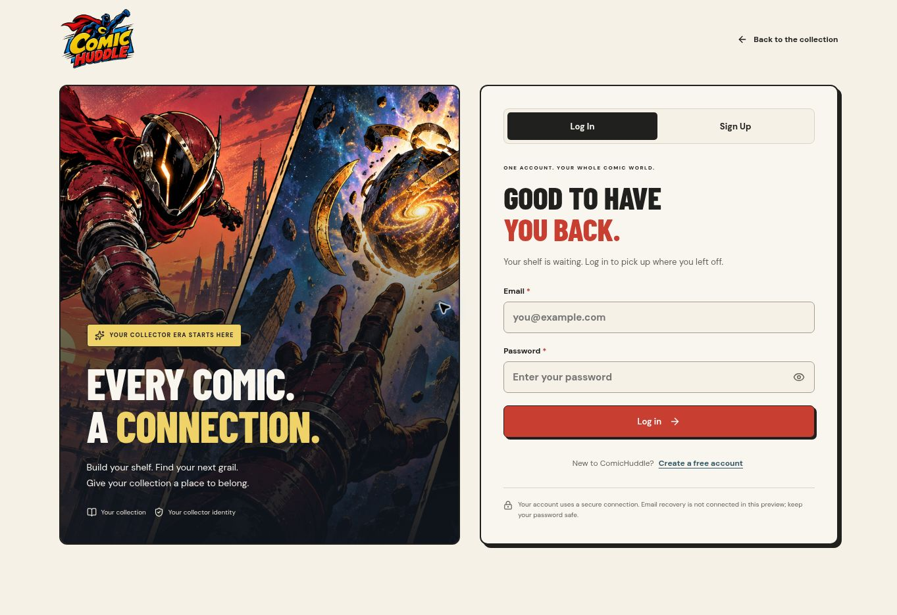
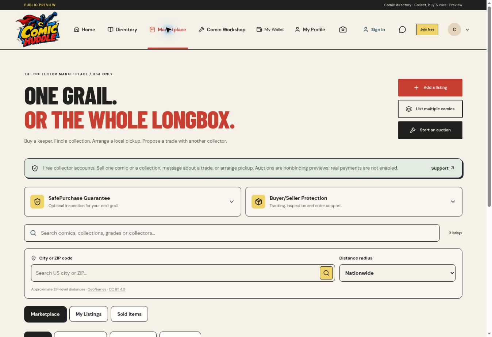
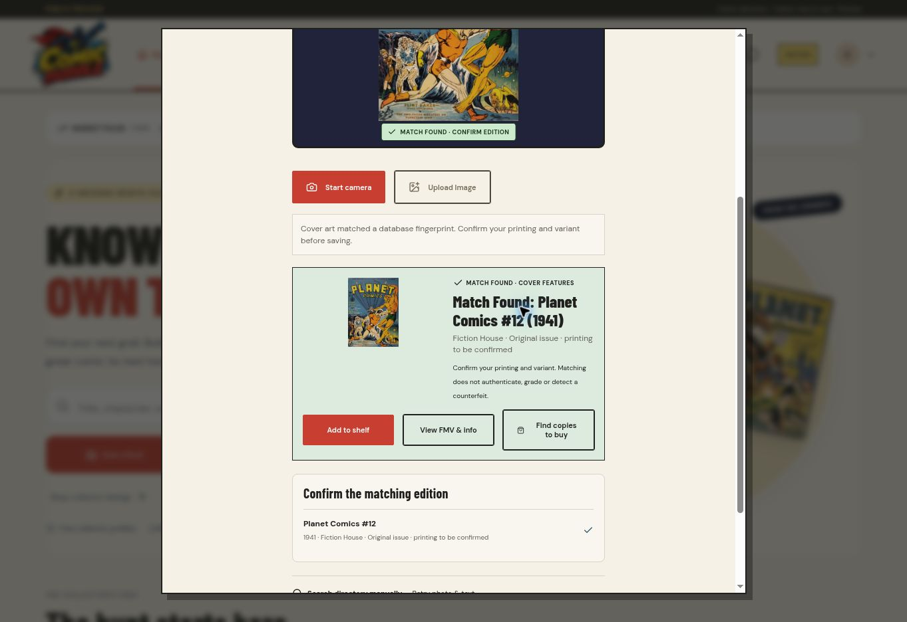

# ComicHuddle UI and scanner diagnostic release

Runtime source: `ccb8567`. Final Vercel deployment: `dpl_EvQEkSRCNZMNbmyLpbkXdRHWB7xu` (READY). Published October 14, 2026 (America/Chicago; October 15 UTC).

Live preview: https://comichuddle-abdul-aziz-akhtars-projects.vercel.app/

## Delivered interface changes

- Wallet and SafePurchase information pages use the global cream/dark theme, condensed headings, comic borders and matching navigation. Public wallet body and main backgrounds were both verified as RGB(245, 241, 231), with no horizontal overflow.
- Auth now has a two-column desktop artwork/form layout, an explicit Log In / Sign Up switch, password visibility control, inline field messages and a transparent SVG logo treatment. Identity fields are trimmed; passwords retain significant whitespace. Registration still requires 12 characters. Login no longer imposes a new-registration length rule on existing accounts. Backend authentication, secure cookies, rate limits and TLS remain enabled. The generic provider pattern error is mapped to an actionable email message. No account was created in this pass.
- Marketplace and Workshop share a search-input component. City/ZIP submit icons sit inside a consistently sized 48-pixel input. Selecting a city keeps its readable city/state label. Marketplace location alignment was verified in the deployed browser; private Workshop interactions were not exercised.
- Marketplace protection information is consolidated into two compact, independently expandable cards: SafePurchase Guarantee and Buyer/Seller Protection. The actual service dependencies remain explicit inside the details. No inspection, insurance or payout capability is falsely represented as connected.
- The account drawer wallet entry uses the drawer palette instead of an unreadable light tile.
- Cover failures use a styled SVG with separate title and issue number in cards and popups. GCD edition displays carry “Cover image source: GCD / Publisher”. Native covers are joined to the requested issue identities with a LEFT JOIN when the source table exists. Missing images never exclude an issue.
- Publisher browsing now searches and pages the complete publisher set. The page no longer mounts thousands of sidebar buttons and native select options. This is presentation pagination, not a limit on catalog coverage.

## Actual native catalog findings

The consistent coverage refresh counted **2,620,274 accessible issues**, observed **2026-10-15T02:22:07.465Z** (October 14, 9:22 p.m. CDT). The refresh counts the active driving issue table plus exact retained additions in one repeatable-read transaction, avoiding millions of optional metadata joins. This is an observed count of the loaded snapshot, not a claim that all worldwide GCD records or images have been imported.

At **2026-10-15T02:22:10.670Z**, RDS contained **220,000 series** and **17,725 publishers**. Series data was being added independently during this work; an earlier observation in this same pass counted 190,000. **`gcd.gcd_cover` was absent.** The deployed view definition confirms LEFT JOINs for series and publisher. A diagnostic initially reported false negatives because PostgreSQL omitted the schema prefix in its formatted view definition; that diagnostic was corrected. No INNER JOIN replacement was needed.

| Requested edition | Directory identity | Cover evidence |
| --- | --- | --- |
| Amazing Fantasy #15 (1962) | GCD 17099 / app 4000017099 | No retained image reference; no native cover table to supply a cover ID or URL. |
| The Amazing Spider-Man #300 (1988), Direct | GCD 44451 / app 4000044451 | Exact retained URL: https://files1.comics.org//img/gcd/covers_by_id/28/w400/28146.jpg . This edition used the fallback in the cloud browser. |
| Marvel Super-Heroes Secret Wars #1 (1984), Direct | GCD 76314 / app 4000076314 | Catalog record exists, but no retained cover reference or native cover row is available. |

The starter bibliography IDs 0 (ASM #300) and 11 (Amazing Fantasy #15) are separate, printing-unconfirmed records and have no cover reference. They do not borrow a particular variant’s image. GCD image paths require actual cover IDs, which differ from issue IDs. Guessing a filename from an issue ID would misidentify artwork.

The previously observed GCD image CDN response was a Cloudflare 1010 access block for the cloud browser; this pass also observed the exact ASM Direct reference falling back in the app. No bypass or alternate-host workaround was attempted. The card and popup use normal cross-origin image elements, so missing metadata and a source-host rejection must not be described as a proven CORS or Next.js remotePatterns defect. The source domains are already allowed in Next configuration. A placeholder cannot supply missing artwork.

To finish cover coverage, load the matching `gcd_cover` source metadata or a licensed, exact issue-to-image export. Preserve cover IDs, issue IDs, restriction/deletion flags and attribution. Source-host access and artwork rights must also permit display. The GCD bibliographic metadata license does not itself license all publisher artwork.

## Scanner implementation and verified limits

The web scanner no longer limits its lookups to the static six-cover JSON file. It now extracts low-frequency DCT perceptual hashes and normalized color/edge descriptors, searches a PostgreSQL-derived feature index using indexed hash bands, resolves candidates against the central catalog, and falls back to automatic on-device OCR. It offers year/edition candidates, Add to shelf, View FMV & info, and Find copies to buy. Crop sampling, luminance normalization and bounded distance/margin checks tolerate moderate framing and color changes; scores are distances, not calibrated probabilities.

Migration `021_catalog_recognition.sql` added exact catalog-linked feature rows, hash-band indexes and rate-limit counters. The importer indexed the six currently usable, locally stored public-domain covers. It fetched **zero external artwork files**. The mechanism can index additional permitted local cover assets without changing a hardcoded reference array, but the database currently still contains **six usable fingerprints**. It is not yet a comprehensive visual index for millions of comics.

A deployed browser upload of the real Planet Comics #12 reference returned **“Match Found: Planet Comics #12 (1941)”** through the database fingerprint route. The result included all three shelf/info/buy actions. This was a focused recognition diagnostic, not a complete E2E test suite.

**Secret Wars remains a recognition limitation:** the supplied screenshot exists in the catalog but is not in the visual feature index. A local OCR diagnostic misread its stylized lettering, including after bounded preprocessing attempts. It was not declared a successful match.

An optional Enhanced cover recognition route is implemented through Vercel AI Gateway using project OIDC and a live-confirmed vision model. It validates/re-encodes the selected cover image, removes metadata, accepts no remote image URLs, uses strict input/output limits, and searches the catalog using the returned identity. It is identification assistance, never authentication, grading, counterfeit detection or printing certification. Images are sent to the named processor only when the user chooses that option. Preview quotas are 8 requests per client/day, 50 globally/day and 250 globally/month; no keys, budgets or billing were created or expanded.

The live setup check returned **“Enhanced vision needs available AI Gateway credits.”** Consequently the enhanced button is disabled with that reason. No paid vision generation was run. The owner must enable available AI Gateway credits in Vercel before that path can be verified. Adding credits will be detected on the next opening of the scanner; no source-code change is required.

## Validation scope

TypeScript and production compilation passed. Vercel deployment and the recognition schema application completed. Public catalog, wallet, SafePurchase and recognition routes returned HTTP 200. The offset-7,000 catalog read returned native records; after series data arrived it showed the real Shadow Comics title and Street & Smith publisher. The login/signup toggle, wallet theme, marketplace accordions, aligned inputs and a database cover match were inspected in the browser.

Optional test suites, account creation, paid transactions, live-camera hardware, protected Workshop bookings and complete multi-device E2E were skipped. The Secret Wars screenshot was not successfully recognized, and no complete-cover or production-readiness claim is made. Screenshots and sanitized route results are retained alongside this report.

## Browser evidence

